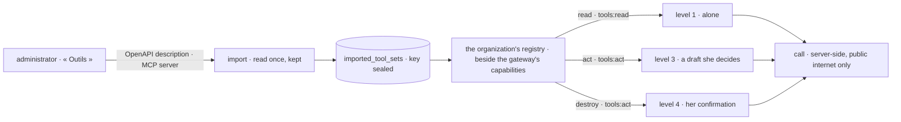

# Spec 093 — « Outils »: the organization's own tools, imported for its agents

C4 of Kete's release (doctrine D-060: « l'import d'outils (OpenAPI, serveurs MCP distants) …
toujours sous les politiques, les gestes engageants en brouillon »); kete-core spec 124
(`@kete/tools`). Run on the author's word of 2026-10-18 (« vas au bout de tout le plan … Sois
autonome »).

## Why

KYA's agents knew Kete Enterprise and the Kete apps, not KYA's own tools. A connector (spec 069)
reads one tool of an ERP and never writes; the registry lent every tool of a remote MCP server to
the assistant at level 1 — including the ones that write, with nobody deciding.

## Requirements

- **FR-001 — Storage**: `0068_imported_tools`: one row per set (OpenAPI or MCP), its prefix unique
  in the organization, its tools as read at the import, its key sealed (AES-256-GCM), its RLS
  policy in the same migration.
- **FR-002 — Import** (`POST /v1/tools`, administrators): the description or the server is read
  once over the public internet only (https, every resolved IP public, no redirection, a timeout);
  an OpenAPI set's calls go where the administrator says, else to its first server. A prefix twice,
  a tool named like one of Kete's, a set without tools are refused. The key never comes back and
  never enters the journal.
- **FR-003 — Rules**: each tool is a capability of the organization's registry, beside the
  gateway's own, under the same host — her rights, the policies at the gesture, the draft budget,
  the journal. A read needs `tools:read` and runs alone; an act needs `tools:act` and is a draft
  she decides; a destruction (`DELETE`, an MCP tool not marked otherwise) waits for her
  confirmation. Each tool's drafts have their own record type.
- **FR-004 — Off**: a set turned off leaves every agent at once (the registry is kept per
  organization until one of its sets changes).
- **FR-005 — Federation**: a registry resource that is an MCP server but not a Kete app lends its
  assistant only the tools it marks read-only; what it does beyond is imported here.
- **FR-006 — The page** « Outils » (`/administration/outils`, administrators): the sets with each
  tool's effect, importing, turning off and back on.

## Proof

- Tests (`tests/tools.test.ts`): a CRM described by OpenAPI and a ticketing MCP server in memory;
  the import reads each operation with its effect, the key absent from the answer, the list and the
  journal; a member, a prefix twice, an address not in https, a Kete name are refused; loopback and
  private addresses are not reachable; through the gateway a read runs alone with the set's key, an
  act and a destruction are prepared and nothing reaches the tool before her decision, then the act
  runs once, journaled with her as actor; a member without the permission sees none; a set turned
  off leaves at once.

## Not done here

Importing a description in YAML; an OAuth connection to a tool (`@kete/connections`) instead of a
key; refreshing a set's tools from its source (an administrator imports it again under another
prefix); per-tool switches inside a set.
