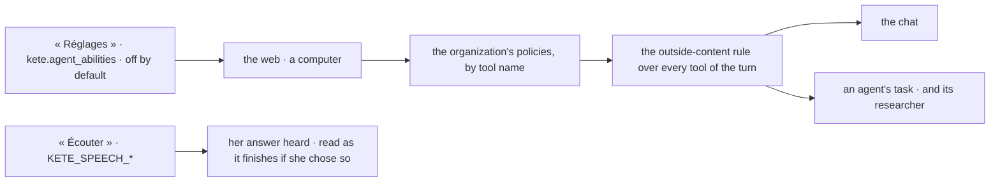

# Spec 094 — The center's agents beyond Kete

C4 of Kete's release, in the center (doctrine D-060: « Des agents à niveau : recherche sur le web,
réponse à voix haute et appel, … un ordinateur dans le bac à sable, sous-agents ; sous les
politiques »); kete-core spec 129. Run on the author's word of 2026-10-18 (« vas au bout de tout le
plan … Sois autonome »).

## Why

The assistant and the agents knew the center and its apps, nothing else: no price looked up on the
web, no page read, no computation run, no answer heard.

## Requirements

- **FR-001 — The organization decides**: `kete.agent_abilities` (the web, a computer) in « Réglages »,
  set by an administrator for the center or a unit; none by default.
- **FR-002 — The web**: `web_search` on the model provider's own search (OpenAI, Anthropic), `web_read`
  over the public internet only.
- **FR-003 — A computer**: a sandbox of the instance (`KETE_SANDBOX_API_KEY`) kept for a conversation
  (migration `0069_conversation_computer`), one per agent's task deleted at its end.
- **FR-004 — Under the policies**: each ability passes the organization's policies by its name
  (`underPolicies`); every tool of a chat's turn is guarded together (`guardOutside`): once a page or a
  computer's output was read, nothing acts at once; an agent's task runs with `outside` set.
- **FR-005 — A researcher**: an agent's task can hand a question to a sub-agent with the web only.
- **FR-006 — Said aloud**: `POST /v1/assistant/speech` (`KETE_SPEECH_PROVIDER`, `KETE_SPEECH_MODEL`:
  OpenAI or Mistral's Voxtral), metered; « Écouter » under each answer in the drawer; answers read as
  they finish for a person who chose `kete.spoken_answers`.

## Proof

`tests/abilities.test.ts` (7): nothing beyond Kete by default; a member cannot turn it on, an
administrator does; the web searched and read, and a gesture that lands at once waits after it — the
same gesture lands in a turn that read nothing; one computer for a whole conversation; an agent's
task offered the web, a computer and the researcher; an answer said by the instance's voice, read as
it finishes once she chose so, refused where there is no voice.

## Not done here

Phone calls with an agent (decision 0012); the computer's screen shown in the drawer.
