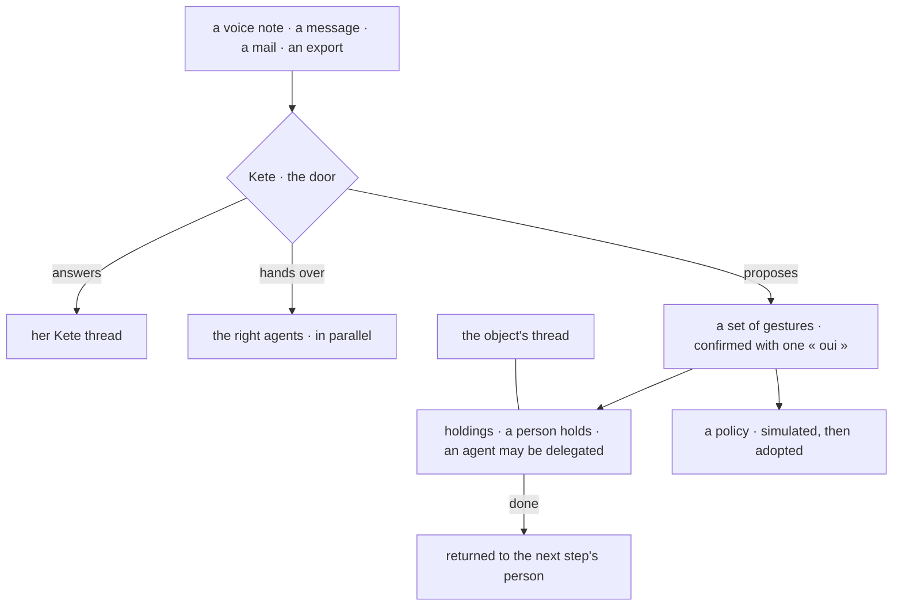

# Spec 099 — The enterprise talks here: threads, Kete's door, agents as delegates

The author validated the canvas v6.2 on 2026-10-21 (« C'est complet ? Si oui, rédige toutes les
décisions et implémente de bout en bout »). The decisions are the doctrine's D-061. The shared
packages are kete-core's spec 140. The reference screens are kete-core's
`docs/brief-ui/canevas-v6.2.html`, and every screen here is built and screenshot beside it.

## Requirements

### The threads, at today's level

- **FR-001 — The conversation.**
  - « Fils » is `@kete/conversation`, fed by the center's routes: reactions, pins, deletions,
    voice notes and their transcripts, citations « # » with their live state, pages, typing,
    « Seulement pour vous » and sharing.
  - The composer has two toggles, « Interne / Au client » and « Pour info / Pour action ». The
    action carries whom, when and how urgent.
- **FR-002 — « Infos du fil ».** It gathers the search in the thread, the notification level, then
  pins, photos and videos, documents with versions, links, voice notes, the thread's actions (its
  holdings), its decisions (the cards decided in it) and its members.
- **FR-003 — Voice notes transcribed.** A voice note, recorded in the thread or received on
  WhatsApp, is transcribed through the AI's dictation port. The cost is metered, and the transcript
  is searched.
- **FR-004 — Files on the storage port.** The instance's storage keeps the files: S3-compatible
  in production, on disk when no bucket is set. They are served through the center's routes, with
  the reader's rights.
- **FR-005 — Told at the right moment.**
  - A message tells the members whom `whoToTell` names, in the app at once.
  - Their phone (Web Push) is told only if the message is still unread after three minutes.
- **FR-006 — « # » finds every object.** It covers the center's objects (projects, third parties,
  decisions, holdings, meetings, assets) and the apps' objects through their card. Each object's
  state shows « Cité dans ».

### Kete, the door

- **FR-007 — One conversation with Kete.**
  - The drawer of every page writes into her Kete thread, with the page as context, and answers
    there. The conversations kept before stay readable.
  - « Inviter quelqu'un » turns her Kete thread into a group.
- **FR-008 — Kete hands work over.** When a request belongs to agents she has, Kete hands each one
  its part. Each part shows in her Kete thread with that agent's state, and a link to its thread.
- **FR-009 — « @Kete » is a full turn.**
  - In any thread, « @Kete » runs a full turn: its steps are shown folded, and « Arrêter » stops
    it.
  - An answer that uses what not every member may read comes « Seulement pour vous ».

### Entrusting work

- **FR-010 — A set of gestures from what is said.**
  - A voice note or a message to Kete is understood, attached to its object, posted in that
    object's thread, then answered with a set of proposed gestures, which she confirms in one tap
    or corrects:
    - holdings (whom, when, how urgent, return to);
    - dated facts;
    - routines.
  - Nothing exists before her « oui ».
- **FR-011 — A rule becomes a policy.** When a message states a rule (« tout achat au-delà de
  50 000 F passe par moi »), Kete proposes the policy from the six templates. It shows the policy
  simulated over thirty days, and its author adopts it, tries it, or declines. The rest of the
  message becomes holdings.
- **FR-012 — A person holds.** Every holding has a person for holder:
  - agents are delegates, and the agents' tasks are migrated that way;
  - each holding says whom it returns to;
  - when it is done, that person is told, and the result is posted in the object's thread.

### The agents

- **FR-013 — An agent is a colleague.**
  - Each agent has its own thread, where she gives it work by talking.
  - « Mes agents » lists them by state: needs you, working, finished, idle. The top bar says how
    many are working and how many wait for her.
- **FR-014 — Its work, readable.** A run shows its plan and its steps, each with its level. They
  are folded once finished. She stops it, or speaks to it without stopping it.
- **FR-015 — Its requests never block.**
  - A request shows three answers: « Autoriser une fois », « Toujours… » and « Refuser ».
  - « Toujours… » proposes a policy, simulated over thirty days, that she puts on trial or in force.
  - A request born of a routine expires after ten minutes, and nothing leaves.
  - Signing and paying always come back to a person.
- **FR-016 — Its job description.**
  - Taking on work, gesture by gesture: never, proposes (the default), or takes alone (earned).
    When a person is given a holding that its description covers, the agent proposes to take it,
    or takes it.
  - Its computer: off, or on with a monthly limit in minutes.
  - Whom it returns to.
- **FR-017 — An agent from one sentence.** Kete drafts the job description, the gestures with
  their levels, the triggers and the budget. Nothing exists before « Créer ». The agent starts on
  trial.

### Mail and other conversations

- **FR-018 — Mail as decided.** « Réglages › Mails » says, for each mailbox:
  - what is read: a shared box entirely; a personal box only for known contacts, the « Kete »
    folder, or a thread in copy, and its Sent folder by the same rule;
  - how many mails each routing step placed this week.

  A mail shows cleaned, with its original one tap away.
- **FR-019 — Imports.** A WhatsApp, Telegram or mail export is dropped into a thread:
  - the people are recognized by their numbers, and the unknown ones are associated by hand;
  - what was imported once is never imported twice.

  Two threads can be merged.

## Proof

- API tests for each requirement.
- On the local platform, every screen screenshot beside the canvas v6.2, on a computer and a
  phone, in light and dark:
  - the thread;
  - « Infos du fil »;
  - the Kete thread handing work over;
  - case A (a voice note becomes three gestures) and case B (instructions become a policy and two
    holdings);
  - the agents;
  - the mail settings;
  - an import.
- Support shows a ticket's thread through `@kete/conversation`.
