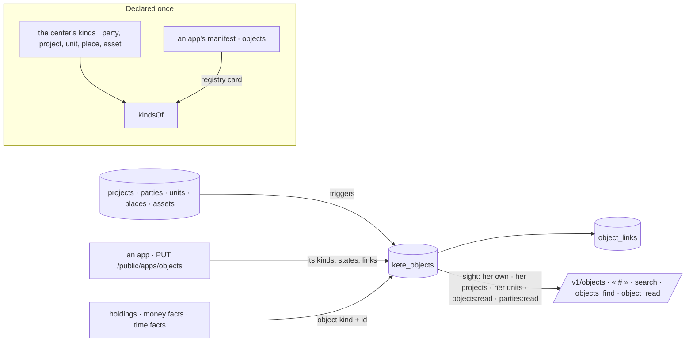

# Spec 100 — Objects at the center

Doctrine D-062 puts the object at the center (R1) with four axes every fact inherits (R2), the
same rights everywhere (R4), every object findable and citable (R15). Kete-core spec 142 gives the
contracts (`object-type.v1`, `object.v1`) and the client (`sayObjects`, `objects`, `object`); this
spec keeps the index, its kinds and its rights in the center.

## Requirements

- **FR-001 — Kinds.** The center declares party, project, unit, place and asset as kinds; the apps'
  kinds come from their manifests in the registry. `GET /v1/objects/kinds` lists them all.
- **FR-002 — The index.** `kete_objects` and `object_links` (with their RLS policies); the center's
  references keep their row by triggers, existing ones included.
- **FR-003 — An app's objects.** `PUT /public/apps/objects` with the app's own token, from the
  active app of that product under that client: only its declared kinds, states and links; at most
  500 at once; an older saying never replaces a newer one; `gone` takes one out.
- **FR-004 — Sight.** What she may read follows the rights she already has: her own objects, her
  projects (or all of them if she reads them all), her units and the reach of `objects:read`, the
  third parties if she reads them, and objects without any axis. A link shows only when both ends
  are hers to read.
- **FR-005 — Places and assets.** Two references, each born with its thread; `objects:manage`
  declares them; who answers for an asset changes its state; an asset produced by a project and
  located at a place says so by named links.
- **FR-006 — Found everywhere.** `/v1/objects` (words, kind, axis, state, closed ones on request),
  `/v1/objects/:kind/:id` (with links both ways and open holdings), « # » in the threads (title and
  state in words), the search, and the gateway's `objects_find` and `object_read`.
- **FR-007 — Facts name their object.** A money fact and a time fact may carry `object`.
- **FR-008 — Screens.** « Équipements »: the fleet grouped by unit, an asset's page (card, axes,
  own figures, state, named links, what is in progress, its thread), a place's page — built against
  canvas v7, « Un objet ».

## The flow

## Proof

- `tests/objects.test.ts`: references indexed by themselves; a place and an asset with their thread
  and links; sight per person (her own, her project, her unit, `objects:read`, nothing else); an
  app's objects refused outside its declarations, stale sayings ignored, gone ones removed, links
  read both ways; « # » and the gateway's tools; a money fact naming its object.
- The demo seeds two places and four assets; screenshots of « Équipements » beside canvas v7.
