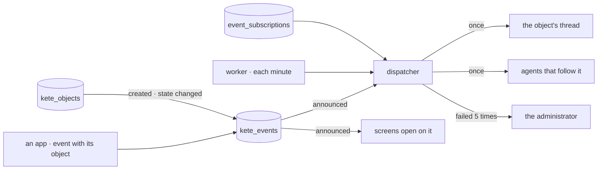

# Spec 101 — One event path

Doctrine D-062 (R11): an object that changes says so, and whoever depends on it learns it — its
thread, the agents that follow it, the screens open on it. Kete-core ADR 0017 decides one path: one
log in the center, a dispatcher, declared subscriptions, consumers that act once. Kete-core spec 143
gives `event.v1` its `object`; this spec keeps the log, the subscriptions and the dispatcher.

## Requirements

- **FR-001 — One log.** `kete_events` (RLS; select and insert only) receives an app's accepted
  business events and the index's changes: an object born, an object changing state.
- **FR-002 — An app's event names its object.** `event.v1`'s `object` is kept; a secret event stays
  in the app's log only.
- **FR-003 — Its thread hears it.** An app's event about an object with an open thread: one line
  said by Kete in that thread, for information.
- **FR-004 — Subscriptions are data.** An agent follows a type (or a family `x.*`), a kind of
  object, a state it reaches; set by its person or a manager of agents, through journaled gestures;
  a kind and a state must exist.
- **FR-005 — An agent that follows it acts.** The event becomes a task for the agent, answered in
  the object's thread; it proposes, commits nothing alone.
- **FR-006 — Once, or shown.** Each delivery is claimed with its effect: a replay acts once. A
  failure is kept and retried up to five times, then shown to the administrator.
- **FR-007 — An object's history.** What happened to an object she may read, the latest first;
  nothing of it for whoever may not read the object.
- **FR-008 — Live.** A screen open on an object is told when it changes and reads it again: the
  asset's page, « Son histoire » (canvas v7, « Un objet »).

## The flow

## Proof

`tests/events.test.ts`: an asset's birth and change of state land in the log, read by who may read
it, hidden from others; an agent's subscription refused to who does not direct it and for an
unknown state; the agent gets one task in the asset's thread when it reaches « En alerte », however
often the dispatch runs; set aside, it stops; Support's event about the asset is said once in its
thread by Kete, a secret one never; a failed delivery is retried, one that used its five attempts is
shown to the administrator only.

## Left for later

- The agent's screen « Quand il se met au travail » lists and edits its subscriptions (spec 146,
  the agents' tools and triggers).
- A person (not only an agent) following an object: her attention (spec 149).
- ~~The routines an app's event triggers (spec 051, `onAppEvent`) and the figure watches still have
  their own trigger: they become consumers of this path with the agents' triggers (spec 146), and a
  figure past its threshold an event with the Measure (spec 144).~~ Done in spec 114.
