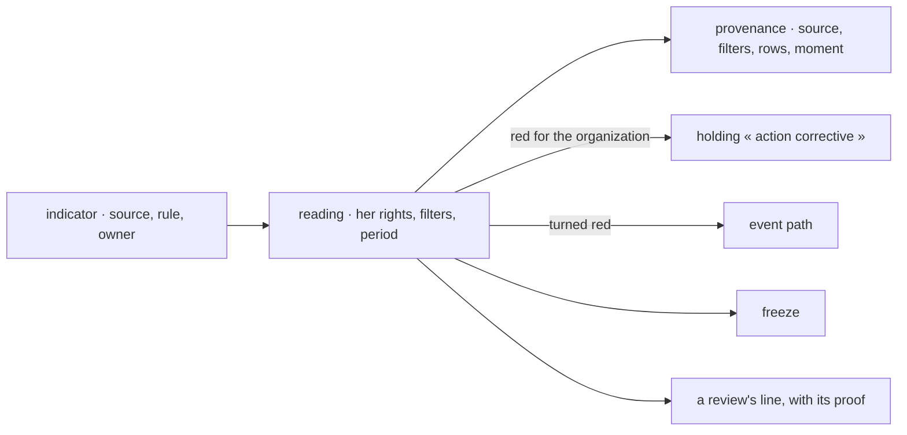

# Spec 102 — The Measure

Doctrine D-062 asks one system for figures: live and proven (R7), filtered by the four axes (R2),
read with the same rights everywhere (R4), missing rather than zero (R17), and a red figure that
obliges someone to act (R11). Kete-core ADR 0015 decides one Measure in four layers — sources,
indicators, readings, freezes; kete-core spec 144 gives the sources their axes and a question summed
up at home. This spec gives the organization's indicators their sources, their live readings, their
consequence and their freezes.

## Requirements

- **FR-001 — Sources.** `GET /v1/measure/sources`: the center's own (holdings, money facts,
  assets — `dataset.v1` with the four axes) and the apps' data sets and figures from the registry.
- **FR-002 — An indicator names its source.** A structured source (`center`, `dataset`, `metric`,
  `typed`), one number from rows or a percentage of two; a unit; a whole rule (direction, target,
  threshold, comparison); an owning position. Set by `performance:manage`, journaled.
- **FR-003 — A live reading, hers.** Read with her rights (the center's rows by the index's sight;
  an app with her token), the filters she asks on the four axes, a period. One aggregation engine:
  `@kete/metrics`' `answerQuery`.
- **FR-004 — Its proof.** Every reading says its source, the filters applied, the period, the rows
  counted and when; a silent source is `missing` and red, never zero; nothing to count is no colour.
- **FR-005 — Several at once.** `POST /v1/measure/readings` for a board's cards.
- **FR-006 — A colour has a consequence.** An organization-wide reading turning red gives the owning
  position's holder a holding « action corrective », once per turn, and `indicator.turned_red` on
  the event path; the worker watches the center's sources every quarter of an hour.
- **FR-007 — Freezes.** `POST /v1/measure/freezes` keeps readings as read; they never change.
- **FR-008 — A review's line from its source.** The line's indicator read for its person or unit over
  the quarter, recorded with its provenance as proof.

## The flow

## Proof

`tests/measure.test.ts`: sources listed; a source set only by who manages the referential, with a
whole rule; the fleet's availability read at 75 % for the organization, 66,7 % for Yao's own assets,
nothing for Essi who sees none, filtered by unit and said; an app's data set asked with her token and
summed up there, then missing and red when the app is silent; one corrective holding per turn to red
for the owner, none for a person's own reading, one event each; the worker's watch; a freeze; a
review's line measured from the source with its proof.

## Left for later

- The board's components — the scorecard, the bullet, the nine charts, « D'où vient ce chiffre ? »
  on every card — and the board's modes (spec 103, kete-core spec 145, ADR 0016).
- An indicator's trend from its freezes; Performance's referential screen editing a source.
- A team's tables and forms summed up by the same engine: their columns are a spreadsheet's headers
  (« Délai »), which `dataset-query.v1` must first accept as field names (kete-core spec 145).
