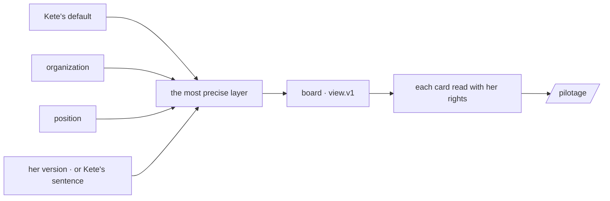

# Spec 103 — Views configured where they are used

Doctrine D-062 (R16, R22): a few generic components configured at the place they serve, the
configuration being versioned data at three levels — the app's default, the organization and its
positions, the person's own version — and changed by Kete on a sentence. Kete-core ADR 0016 and
spec 145 give the contract (`view.v1`), the figures and their React renderer; this spec keeps the
configurations and draws the steering board of canvas v7 with them.

## Requirements

- **FR-001 — A place shows a view.** `GET /v1/views/:place` answers the view she sees, its level and
  version, and the layers that reach her. « Pilotage » (`board:steering`) has Kete's default.
- **FR-002 — Each card read for her.** `POST /v1/views/read`: indicators, a center table, an app's
  data set or figure, objects — with her rights, the board's unit and period; groups by a unit, a
  project or a third party are named; empty, missing and denied are said.
- **FR-003 — Layers.** The organization's and a position's versions by an administrator, her own by
  her; the most precise wins whole; a view breaking `view.v1` is refused where it is written.
- **FR-004 — Versions.** Every change keeps the one before; she goes back to a version, or to none.
- **FR-005 — Kete on a sentence.** `view_read` and `view_change` (level 2): her own version,
  journaled, undone.
- **FR-006 — One engine.** A team's tables and forms are summed up by `@kete/metrics`' engine, like
  an app's data sets — a spreadsheet's headers are fields like any other (kete-core #168).
- **FR-007 — The screen.** « Pilotage »: the grid, the phone's order, the period and unit filters,
  the provenance on every card, the way back to the shared board — built against canvas v7.

## The flow

## Proof

`tests/view-configs.test.ts`: the default board and its charts; a card read by state and by unit,
named, for the administrator, and empty for who reads nothing; the organization's version refused to
a member and to a broken view; her version over the organization's, its versions, back to one and to
none; Kete reading and changing her version through the gateway, journaled as an agent's gesture,
then undone.

## Left for later

- The board's meeting and story modes, cross-filtering by a click, drag to move a card, « Figer ».
- Slots on an object's page, « Pour moi » and a thread's side panel; the apps' default views in
  their manifest.
