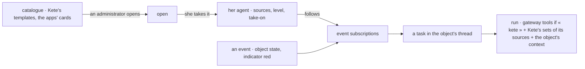

# Spec 104 — Agents draw on their sources, know their object, come from a catalogue

Doctrine D-062 (R5): an agent is Kete narrowed to a job description, and its job description
chooses its sources of tools — it receives only those, never every tool at once. Kete-core ADR 0018
and spec 146 decide one assembly of tools, sources, the object's context, triggers on events and a
catalogue of agents the products ship.

## Requirements

- **FR-001 — Sources.** An agent's job description names its sources: « kete » (the gateway's
  gestures, narrowed as before by its permissions, levels and budget) and Kete's own sets — the
  library, a team's tables, forms, document templates, dashboards. It receives only those, each
  open when its module is on, each tool reading with its person's rights, never above its level.
  « kete » by default: what every agent had.
- **FR-002 — Set by its person.** The sources are part of its job description at work
  (`set-agent-job`), journaled with what they were; never empty.
- **FR-003 — The object's context.** A task given in an object's thread starts with the object's
  card — its state, named links, what is in progress — and the last words of its thread, read with
  its person's rights.
- **FR-004 — A catalogue.** Kete's own templates (« Agent Parc », « Agent Indicateurs ») and those
  the apps' cards declare (`agent-template.v1`); an administrator opens one to everyone, or closes
  it; a person sees only what is open.
- **FR-005 — Taken by a person.** A template becomes her own agent: its mission, sources,
  permissions, level, take-on, routine, and a subscription for each event it follows (spec 101).
- **FR-006 — Screens.** « Nouvel agent » shows the agents ready to take; the agent's panel shows
  its sources, which she changes, and the events that set it to work.

## The flow

## Proof

`tests/agents-sources.test.ts`: the catalogue closed to a member until an administrator opens a
template; taking it gives her an agent with its mission, sources, take-on and the subscription to an
asset turning to alert; the asset turning red wakes it once, its task in the asset's thread, its
context naming the asset, its state and the project it was produced by; a set of Kete's own reaches
it only when its sources name it and within its level; its person changes its sources, journaled,
never to none.

## Left for later

- Apps' tools for an agent working in the background: the Compte Kete must grant an agent a
  standing mandate (consent once, revocable) — today a mandate is exchanged from the person's live
  token, which a worker does not hold. Asked at the person's request (in her thread), apps' tools
  stay the assistant's.
- Skills named by the job description; memory, budgets and evaluations (spec 148); faces (149).
